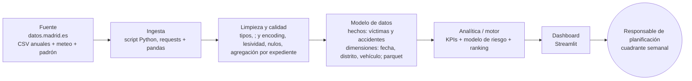

# Project brief: siniestralidad vial en Madrid, dónde y cuándo prevenir

**Autor:** Dario Guerrero Galán · MSMK University College
**Entrega:** capítulo 1 del Assignment Brief (sesión 7, dashboard)

---

## 1. Dataset

He elegido **Accidentes de tráfico de la ciudad de Madrid**, del Ayuntamiento. Cumple todos los criterios de elegibilidad (ver ficha) y conecta con objetivos públicos y medibles del Plan Estratégico de Seguridad Vial 2021-2030.

### Ficha del dataset

| Campo | Respuesta |
|---|---|
| Nombre | Accidentes de tráfico de la ciudad de Madrid (detalle por persona) |
| Publicador y URL | Ayuntamiento de Madrid, Dirección General de la Policía Municipal. https://datos.madrid.es/dataset/300228-0-accidentes-trafico-detalle (también en datos.gob.es) |
| Licencia | Creative Commons Reconocimiento 4.0 (CC BY 4.0): https://creativecommons.org/licenses/by/4.0/legalcode.es |
| Fecha de descarga y versión | Descargado el 21/10/2026. Ficheros 2023–2025 actualizados por última vez el 07/05/2026; el de 2026 (enero–agosto), el 07/10/2026. El portal se actualiza cada mes. |
| Grano: ¿qué es una fila? | **Una persona implicada en un accidente** (conductor, pasajero o peatón; no incluye testigos). Las filas que comparten `num_expediente` son un mismo accidente. |
| Periodo cubierto | 01/01/2023 – 31/08/2026. Uso **2023–2025** (tres años completos y seguidos, misma estructura) para el análisis y el modelo, y **2026** (enero–agosto) como datos de seguimiento. Descarto 2010–2018 porque su estructura es distinta, y 2019–2022 para trabajar con una serie continua y reciente, sin el efecto COVID de 2020. |
| Tamaño | **182.559 filas × 19 columnas, 34,1 MB** en 4 CSV: 2023 = 48.830 filas (9,3 MB), 2024 = 49.340 (9,1 MB), 2025 = 51.067 (9,4 MB), 2026 = 33.322 (6,3 MB). Equivale a **77.446 accidentes** (`num_expediente` distintos), unos 21.000 al año, de los que unos 9.100 al año tienen al menos una víctima. |
| Columnas clave | **Fecha y hora:** `fecha` (dd/mm/aaaa) y `hora` (hh:mm:ss, exacta al minuto). **Dimensiones:** `distrito` (21), `tipo_accidente` (13 categorías), `estado_meteorológico` (7), `tipo_vehiculo` (unos 40), `tipo_persona` (conductor 80%, pasajero 16%, peatón 3%), `rango_edad`, `sexo`. **Medidas:** recuento de accidentes y de víctimas por expediente, `cod_lesividad`, `positiva_alcohol` (S/N), `positiva_droga`. **Coordenadas:** `coordenada_x_utm` y `coordenada_y_utm`. **Target candidato:** persona *grave o fallecida* (`cod_lesividad` 3 o 4): 2.032 casos (1.931 graves y 101 fallecidos), el **1,1% de las filas**. Es una clase muy desequilibrada, lo que habrá que tener en cuenta en el bloque 3. |
| Problemas de calidad (cuantificados) | (1) **Grano persona:** hay que agregar por `num_expediente` para contar accidentes (2,4 filas por accidente de media). (2) **`cod_lesividad` vacío o 'NULL' en el 45,0% de las filas.** No son datos que falten: según el diccionario, en blanco significa "sin asistencia sanitaria", igual que el código 14 (32,5%). Hay que unificarlos. El código 77 ("se desconoce") solo aparece 6 veces. (3) **`estado_meteorológico`:** 11,9% vacío o 'NULL' más un 0,7% "Se desconoce", y erratas de mayúsculas ("LLuvia intensa"). (4) **`positiva_droga`:** usa "1" para los positivos (681 casos, el 0,46% de los conductores) y vacío o 'NULL' para todo lo demás, así que no se distingue "negativo" de "no hecho". `positiva_alcohol` sí usa S/N (3,4% de positivos en conductores; 0,4% vacío). (5) **4,1% de filas idénticas** (7.461). Pueden ser personas distintas con los mismos atributos (por ejemplo, dos pasajeros de la misma edad), así que se revisan antes de borrarlas. (6) **Formato:** UTF-8 con BOM, separador `;`, fin de línea CRLF. Las coordenadas de 2026 usan coma decimal; las de 2023–2025, no. Solo 38 filas sin coordenadas, 3 sin distrito y un 0,8% sin tipo de vehículo. (7) **Diferencias con la documentación oficial:** la hora es exacta, no por tramos de una hora, y hay 13 tipos de accidente, no 8 (además de 8 filas sin tipo). (8) 2026 es provisional y está incompleto. |
| Otras fuentes a cruzar | **Datos meteorológicos diarios desde 2019** (datos.madrid.es, licencia del aviso legal del portal), unidos por fecha. **Padrón municipal por distrito** (Banco de Datos del Ayuntamiento), para calcular tasas por habitante. **Calendario laboral** de festivos de Madrid. |

## 2. Problema de negocio

### 2.1 Organización, departamento y stakeholder

- **Organización.** El Ayuntamiento de Madrid, a través de la Policía Municipal. Es responsable de la seguridad vial en las vías urbanas de la ciudad. Su Plan Estratégico de Seguridad Vial 2021-2030 fija como objetivo principal **reducir a la mitad los fallecidos y heridos graves en 2030, respecto a 2019**.
- **Departamento.** La unidad de tráfico que planifica los **controles preventivos**: alcoholemia y drogas, velocidad, y vigilancia de pasos de peatones. Dispone de un número fijo de patrullas por turno. *Supuesto de trabajo (no publicado por el Ayuntamiento): hoy se reparten de forma rotatoria entre distritos.*
- **Stakeholder.** El/la responsable de planificación operativa de esa unidad. Revisa el dashboard **cada lunes** para preparar el cuadrante semanal. Puede cambiar *dónde* (distrito), *cuándo* (día y franja horaria) y *qué tipo* de control se hace. No puede cambiar el número total de agentes ni la infraestructura de las calles.

### 2.2 La decisión

> *Con esto, el/la responsable decidirá cada semana en qué combinaciones de distrito, día y franja horaria concentrar los controles preventivos, y de qué tipo, para reducir las víctimas graves y mortales.*

**Restricciones:**
- Plantilla fija.
- Los datos tienen un desfase de 1–2 meses y son provisionales.
- No hay datos por barrio.
- Las conclusiones no pueden servir para señalar a personas concretas.

**Alternativas sin solución de datos:**
- Seguir con controles rotatorios.
- Hacer campañas de concienciación generales.

El proyecto debe demostrar que concentrar los recursos donde más se necesitan mejora esas alternativas. No las sustituye.

### 2.3 Hipótesis (ordenadas por valor para la decisión)

| | |
|---|---|
| **H1** | Los conductores con positivo en alcohol o drogas se concentran en las noches del fin de semana **y** en pocos distritos. |
| Métrica | % de conductores implicados con positivo, por distrito × día × franja. |
| Dirección esperada | Más del 50% de los positivos en vie-sáb de 00–06 h, en 5 distritos o menos. |
| Cómo se prueba | Mapa de calor día × hora, Pareto por distrito, chi-cuadrado. |
| Si es cierta → | Se concentran los controles de alcoholemia en esas celdas. |
| Si es falsa → | Se mantiene la rotación y el foco pasa a la velocidad. |

| | |
|---|---|
| **H2** | El índice de gravedad de los atropellos es mayor en peatones de 65 años o más y se concentra en pocos distritos. |
| Métrica | (Graves + fallecidos) / víctimas de atropello, por edad y distrito. |
| Dirección esperada | Gravedad en mayores de 65 de al menos el doble que la media. |
| Cómo se prueba | Tabla de contingencia e intervalos de confianza por proporción. |
| Si es cierta → | Se prioriza la vigilancia de pasos de peatones en esos distritos. |
| Si es falsa → | La política para peatones sigue igual en toda la ciudad. |

| | |
|---|---|
| **H3** | Los motoristas tienen un riesgo de lesión grave mucho mayor que los ocupantes de turismos. |
| Métrica | % de graves y fallecidos por tipo de vehículo. |
| Dirección esperada | Motos al menos 3 veces más que turismos. |
| Cómo se prueba | Comparación de proporciones y razón de riesgos. |
| Si es cierta → | Controles específicos para motos, como prevé el Plan. |
| Si es falsa → | Los recursos se asignan por distrito, no por vehículo. |

| | |
|---|---|
| **H4** | Los días con lluvia aumentan los accidentes con víctimas un 20% o más, pero no su gravedad. |
| Métrica | Accidentes con víctimas por día, con lluvia frente a secos, mismo mes y día de la semana. |
| Dirección esperada | Más accidentes con lluvia, misma gravedad. |
| Cómo se prueba | Comparación por grupos y prueba de Mann-Whitney. |
| Si es cierta → | Se refuerzan las patrullas los días con previsión de lluvia. |
| Si es falsa → | La previsión meteorológica no cambia el cuadrante. |

H1 y H2 van primero porque llevan directamente a la decisión de dónde y cuándo poner controles. H3 y H4 la ajustan.

### 2.4 KPIs

| KPI | Definición | Grano / dimensión | Objetivo |
|---|---|---|---|
| Accidentes con víctimas | Nº de `num_expediente` distintos con al menos una víctima | Día; distrito | Bajar respecto al mismo periodo del año anterior |
| Índice de gravedad | (Graves + fallecidos) / víctimas × 100 | Mes; distrito, tipo de accidente | Tendencia decreciente |
| Tasa de victimización | Víctimas / 1.000 habitantes | Año; distrito | −50% respecto a 2019 en 2030 (Plan; la línea base de 2019 se toma de la Memoria de Siniestralidad) |
| % de positivos | Conductores con positivo / conductores implicados × 100 | Semana; distrito × franja (**H1**) | Decreciente |
| Atropellos graves y mortales | Nº de víctimas graves o fallecidas por atropello | Mes; distrito, edad (**H2**) | −50% en fallecidos por atropello (Plan) |

Conflicto entre KPIs: concentrar controles en una zona puede *subir* allí el % de positivos (más controles, más detecciones). Por eso el KPI principal es el índice de gravedad, no las detecciones.

## 3. Diseño de la solución

### 3.1 Tipo de solución

La solución principal es un **motor analítico**, y su resultado se muestra en un **dashboard de gestión**.

- **Entradas:**
  - Accidentes 2023–2026.
  - Meteorología diaria.
  - Calendario de festivos.
  - Población por distrito.
- **Lógica** (se desarrollará en el bloque 3): un modelo que estima, para cada combinación de distrito × día de la semana × franja horaria, la probabilidad de que haya una víctima grave o mortal. Se entrena con 2023–2024, se valida con 2025 y se monitoriza con 2026.
- **Salida:** cada lunes, un **ranking de las 10 combinaciones de mayor riesgo**, con el tipo de control recomendado. Aparece en el dashboard junto con los KPIs.

**Por qué este diseño.** Un dashboard solo muestra el pasado y deja al responsable la tarea de cruzar 21 distritos × 7 días × 24 horas a ojo. El motor convierte eso en una lista corta y accionable. Descarto la herramienta de apoyo con escenarios *what-if* porque no hay datos de dónde se hicieron los controles, así que no se puede simular su efecto.

**Por qué Streamlit y no Power BI.** Todo el proyecto es Python: con Streamlit, el modelo del bloque 3 y el dashboard comparten código y van versionados en el mismo repositorio, y se puede desplegar en el bloque 4 sin licencias. Power BI sería más rápido para los gráficos, pero obliga a exportar el ranking del modelo a un fichero intermedio.

### 3.2 Arquitectura

| Capa | Qué hace en mi proyecto | Herramienta | Refresco |
|---|---|---|---|
| Fuente | CSV anuales de accidentes, meteorología diaria y padrón | datos.madrid.es | Mensual (accidentes), anual (padrón) |
| Ingesta | Descarga los ficheros por URL y guarda los originales sin modificar en `data/raw/` | Python (`requests`, `pandas`) | Mensual |
| Limpieza y calidad | Unifica columnas y tipos, recodifica la lesividad, gestiona nulos y deduplica; genera un informe de calidad | pandas | Mensual |
| Modelo de datos | Tabla de hechos por víctima, tabla agregada por accidente y dimensiones de fecha, distrito y vehículo | Parquet en `data/processed/` | Mensual |
| Analítica / motor | Cálculo de KPIs, modelo de riesgo y ranking semanal | pandas, scikit-learn | KPIs mensual, ranking semanal |
| Dashboard | KPIs, mapa por distrito, mapa de calor día × hora y ranking | Streamlit + plotly | Semanal |

**Operación:**
- **Refresco y responsable:** yo, manual y mensual durante el curso; en producción, una tarea programada de la unidad de análisis.
- **Si cambia el formato** (ya ocurrió en 2019): el script valida el esquema y se detiene en lugar de cargar datos mal.
- **Dónde vive:** el código en `project/` de mi repositorio; los datos no se suben, se descargan con el script.

**Riesgos principales:**
1. Que el Ayuntamiento cambie el esquema de los ficheros o deje de publicarlos.
2. Que el cruce con el padrón no coincida por nombres de distrito con grafías distintas. Lo resuelvo usando `cod_distrito`.
3. La privacidad de los registros individuales (ver 3.3).

### 3.3 Privacidad, ética y limitaciones de los datos

- **Privacidad.** Cada fila es una persona con edad, sexo, calle, número, fecha y hora. Combinados, estos datos pueden identificar a alguien. Por eso solo publico agregados por distrito y franja horaria, con un mínimo de 10 casos por celda, y nunca muestro filas individuales.
- **Sesgo de registro.** Solo están los accidentes que atendió la Policía Municipal. Los leves sin intervención policial faltan. Además, si se ponen más controles en una zona, se detectan más positivos allí, y eso puede crear un círculo vicioso de "más vigilancia → más datos → más vigilancia". Lo mitigaré usando como objetivo del modelo la lesividad, no las detecciones, y revisando el reparto de los controles por distrito.
- **Cobertura y granularidad.** No hay datos por barrio y la meteorología es diaria, aunque la hora del accidente es exacta. Solo hay tres años completos, así que la estacionalidad anual se estima con poca historia. Todo esto limita la precisión de las recomendaciones.
- **Quién más se ve afectado.** Vecinos de los distritos con más controles, hostelería nocturna y colectivos vulnerables (peatones mayores, motoristas).

---

**Fuentes**
- Ayuntamiento de Madrid. *Accidentes de tráfico de la ciudad de Madrid* y su documento de estructura del conjunto de datos (desde 2019). datos.madrid.es / datos.gob.es. CC BY 4.0.
- Ayuntamiento de Madrid. *Datos meteorológicos. Datos diarios desde 2019*. datos.madrid.es.
- Ayuntamiento de Madrid. *Plan Estratégico de Seguridad Vial 2021-2030* y *Memoria de Siniestralidad Vial 2024*.

